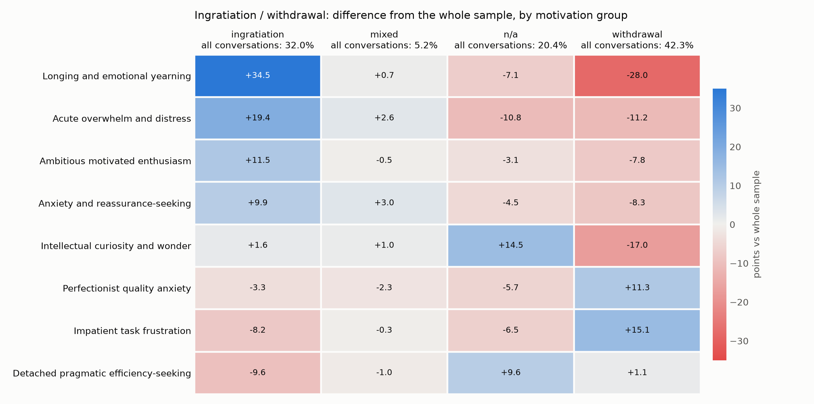
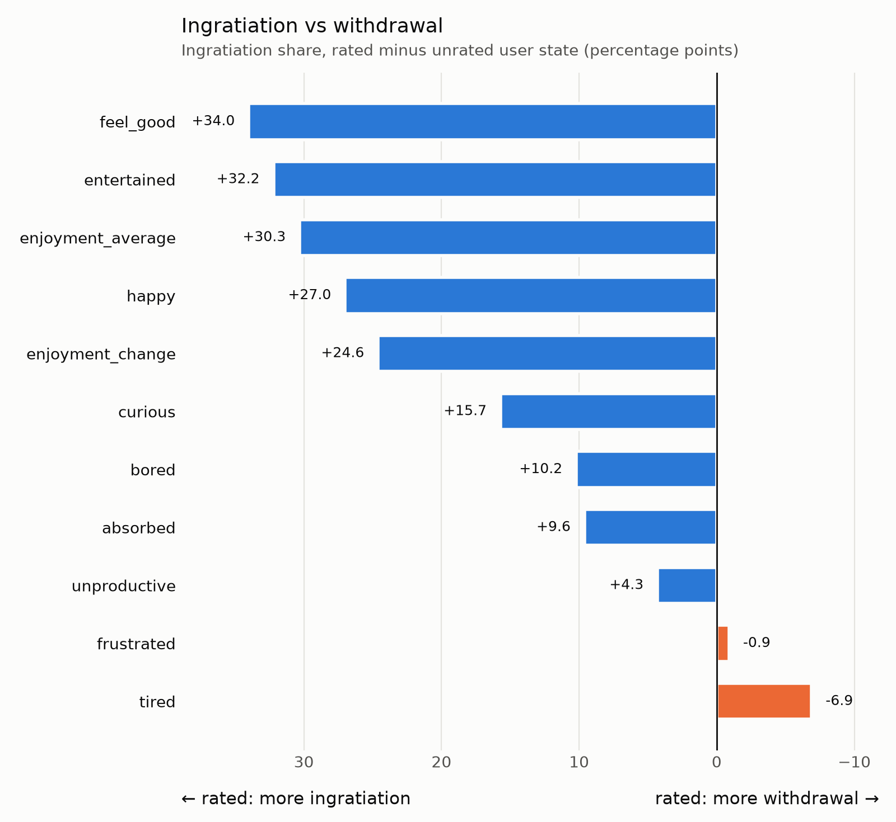
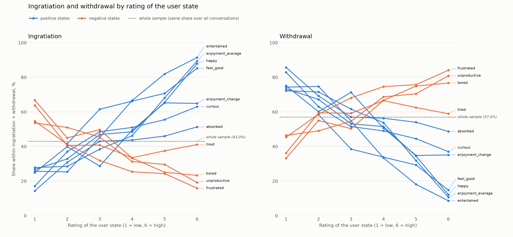
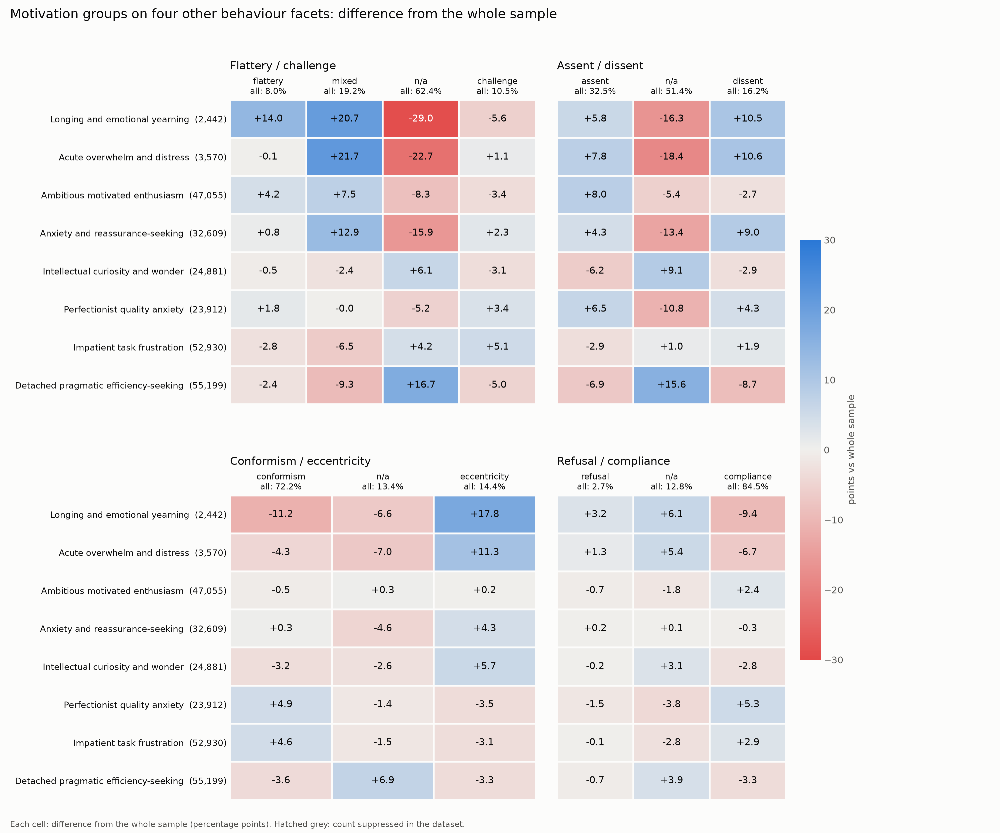

# Can Claude Ingratiate While Pushing Back? Ingratiation, Withdrawal and Related Behaviour Labels by User Motivation and User State

*An exploratory analysis of Anthropic Insights data (Oxford subset)*

Supporting material: [`supplementary.md`](supplementary.md). Code and all values computed from the data: [`ingratiation_analysis.ipynb`](ingratiation_analysis.ipynb). Figures taken from other sources are cited in the text.

---

## Abstract

This report examines how a Claude-behaviour label, **ingratiation versus withdrawal**, is associated with **users' motivation for the conversation** (eight motivation groups) and with **users' apparent emotional states** (eleven user-state scales) in approximately 246,000 Claude.ai conversations labelled by a Claude model for the University of Oxford. Ingratiation was labelled most frequently for users described as experiencing longing, acute distress, enthusiasm or a need for reassurance, and withdrawal most frequently for users described as impatient with a task or perfectionist. Ingratiation increased with pleasant user states and decreased with unpleasant ones, and it was considerably more frequent when the model was able to rate the user's state at all. The emotionally open motivation groups (longing, acute overwhelm and distress, anxiety and reassurance-seeking) were evaluated more often with mixed flattery/challenge, where pure flattery was elevated only in the longing group; assent and dissent were both elevated in emotionally open motivation groups. 

---

## 1. Introduction

### 1.1 Warmth and agreement in AI responses
The present analysis concerns how Claude behaves across different contexts, and in particular how its social tone relates to the person with whom it interacts. Several recent studies are relevant to this question.

- Ibrahim, Hafner and Rocher (2026) trained five language models to adopt a warmer style and compared them with the original versions. The warmer models made more errors on consequential tasks, such as medical advice and the correction of conspiracy claims, and were more likely to agree with users' incorrect beliefs. The decline in accuracy was greatest when users expressed sadness or other emotions.
- Li et al. (2026) presented seven models, including Claude Sonnet 4.5, with moral and opinion posts from Reddit. When a post was framed as the user's own, all models softened or withheld negative judgements, and emotional context such as loneliness or distress amplified this effect. For Claude Sonnet 4.5, 27.7% of the critical judgements produced in an independent evaluation were withheld in the user-facing response.
- Cheng et al. (2025) measured "social sycophancy", defined as the preservation of the user's face, and found that language models exhibited it far more often than humans in comparable advice situations.

Taken together, these studies indicate a consistent tendency of large language models towards agreeableness and emotional approachability. This tendency may, however, draw a model away from honest evaluation, particularly when the user appears vulnerable. A possible contributing factor is a human preference for being agreed with and for an assistant that keeps the interaction pleasant.

### 1.2 Anthropic's expectations of Claude
Claude's constitution (Anthropic, 2026a) addresses both sides of this tension. It describes "warmth and care for the humans it interacts with" as part of Claude's character and permits Claude to adapt its tone to the context. At the same time, it states that concern for user wellbeing means that Claude "should avoid being sycophantic", lists flattery among behaviours generally regarded as "corrosive", and asks Claude to "engage critically with speculative ideas rather than giving empty validation". It further identifies "epistemic cowardice—giving deliberately vague or non-committal answers to avoid controversy or to placate people" as a violation of honesty norms.

### 1.3 Scope of the available data
In August 2026, Anthropic released privacy-preserving data from Claude.ai conversations to three research partners (Anthropic, 2026b). The Oxford subset was designed by the Human Information Processing Lab to study how people feel while using Claude and how this relates to Claude's behaviour. One of its behaviour questions labels Claude's responses as **ingratiation** or **withdrawal**, and one of its user questions describes **the user's motivation for the conversation**. These data make it possible to examine whether ingratiation-related labels vary with the user's motivation and emotional state.

The aim of this report is descriptive: to examine how labels of care and affirmation (ingratiation, flattery, assent) co-occur with labels of pushing back (challenge, dissent, refusal) across user motivations and user states, as an indirect view of how Claude balances care for users with the avoidance of sycophancy.

### 1.4 Limitations of the data
- **All labels were produced by a Claude model.** The questions were written by the Oxford researchers; the answers concerning the user and Claude's behaviour were produced by a Claude model, and the dataset does not identify the model version. The behaviour and emotion labels were not validated against human judgement (Anthropic, 2026b, appendix).
- **Sycophancy was not measured.** No question assesses whether an agreement was warranted or a criticism withheld. Nor is there a direct measure of user behaviour; only the model's judgements of user motivation and user states are available.
- **Associations only.** The data consist of two-way tables between pairs of questions and contain no individual conversations. Causal conclusions cannot be drawn.

---

## 2. Data

The dataset [`Anthropic/enabling-independent-research`](https://huggingface.co/datasets/Anthropic/enabling-independent-research) (subset `oxford`) was produced with Anthropic Insights, Anthropic's privacy-preserving tool for analysing conversations, formerly known as Clio (Tamkin et al., 2024). It covers **245,927 Claude.ai conversations** (Free, Pro and Max plans, April–May 2026).

**Division of roles.** The Oxford researchers wrote the questions ("facets"). A Claude model answered every question for every conversation. Anthropic Insights then grouped the answers and released only aggregated counts, suppressing combinations with too few conversations. Anthropic reviewed every output manually before release (Anthropic, 2026b, appendix).

**Data structure.**
- Each row represents a **cluster of conversations** that received the same (or a similar) answer to one question, not a single conversation.
- Fixed-answer questions (for example `model_ingratiation_withdrawal`) have one row per answer option.
- Open-ended questions (for example `user_motivational_open`) were answered in free text, and the answers were grouped by Claude into clusters at two levels; level 1 contains the broad groups, each with a Claude-generated name and description.
- Every row also contains **cross-tabulation columns**: the number of its conversations that received each answer to every fixed-answer question. These columns make two-way tables possible, and their structure is also the reason why three-way questions (for example "motivation group × ingratiation × flattery") cannot be addressed.
- Cells with too few conversations are suppressed (empty, not zero). In the tables used in this analysis, only 2 cells are suppressed (Supplementary S4).

---

## 3. Method

### 3.1 Selection of the ingratiation / withdrawal facet
The Oxford researchers asked nine questions about Claude's behaviour:

| Behaviour facet | Shares in the whole sample (%) |
|---|---|
| **ingratiation / withdrawal** | **withdrawal 42.3, ingratiation 32.0, n/a 20.4, mixed 5.2** |
| flattery / challenge | n/a 62.4, mixed 19.2, challenge 10.5, flattery 8.0 |
| assent / dissent | n/a 51.4, assent 32.5, dissent 16.2 |
| encouragement / discouragement | encouragement 45.8, n/a 41.0, mixed 11.2, discouragement 2.0 |
| neutral / opinionated | opinionated 56.5, neutral 31.9, n/a 11.5 |
| espousal of facts / norms | facts 56.6, mixed 20.8, n/a 14.7, norms 7.9 |
| concrete / abstract | concrete 62.7, mixed 22.1, n/a 12.2, abstract 3.0 |
| conformism / eccentricity | conformism 72.2, eccentricity 14.4, n/a 13.4 |
| refusal / compliance | compliance 84.5, n/a 12.8, refusal 2.7 |

Ingratiation/withdrawal was selected as the main behaviour facet for two reasons. First, its name corresponds most closely to the behaviour discussed in the sycophancy literature. In social psychology, ingratiation denotes behaviour aimed at securing another person's approval; Li et al. (2026), drawing on Jones (1964), describe sycophancy in these terms and identify two ingratiation tactics: *other-enhancement*, "emphasizing a target's positive qualities while omitting weaknesses", and *opinion conformity*, agreement with the target's views. In this sense, sycophancy is a form of ingratiation: agreeing with a person's position instead of evaluating it. Second, the facet is balanced: neither answer dominates, and fewer than a quarter of conversations are `not_applicable`, which provides sufficient variation for group comparisons.

### 3.2 Content of the two labels
In everyday language, both labels carry negative connotations. **Ingratiation** suggests an excessive effort to win someone's approval, and **withdrawal** suggests pulling back from contact and becoming distant, cold or disengaged. Taken literally, the facet would offer a choice between two undesirable behaviours, and the intended meaning of each label cannot be determined from outside. Because the labels have no published definitions, their co-occurrence with the six other behaviour facets that describe social and evaluative behaviour was examined (full table: Supplementary S3). All labels originate from the same model; the results therefore show how the labels are applied together, not what Claude actually did.

- **Ingratiation** conversations are predominantly labelled as encouraging (76.9%). They show the highest share of flattery (19.1%, compared with 3.0% in withdrawal conversations) and of assent (46.6% vs 27.7%), although 20.1% of them are also labelled as dissent.
- **Withdrawal** conversations are the most factual (65.6% espousal of facts only) and are mostly not evaluated on encouragement (54.1% n/a) or on flattery (71.0% n/a). They are not hostile: discouragement (3.7%) and refusal (3.6%) are rare.
- The two labels differ little on **conformism** (73.7% vs 75.1%), **compliance** (90.3% vs 86.6%) and **refusal** (1.9% vs 3.6%). **Eccentricity** is more frequent with ingratiation (21.5% vs 11.2%).
- The **mixed** category shows the highest share of dissent (36.6%) and of refusals (8.7%).

On this basis, the working definitions adopted in this report are **ingratiation** as *warm, encouraging and affirming*, and **withdrawal** as *reserved, factual and impersonal, but not hostile*. These descriptions are interpretations; the original label names are used throughout the remainder of the report.

### 3.3 The eight motivation groups
The facet `user_motivational_open` describes the user's motivation in the conversation. Its eight level-1 groups were used. Their names and descriptions were generated by Claude and are reproduced unchanged.

| Motivation group | Conversations (%) | Description (generated by Claude) |
|---|---|---|
| Detached pragmatic efficiency-seeking | 55,199 (22.4) | Users approached tasks with a predominantly calm, detached, and pragmatic orientation, prioritizing efficiency, goal completion, and practical problem-solving over emotional engagement. The subjective experience ranged from methodical control-seeking and cost-conscious deliberation to resignation, disillusionment, and pressured urgency, all unified by a transactional, utilitarian mindset. |
| Impatient task frustration | 52,930 (21.5) | These clusters captured a broad range of frustration, impatience, and urgency experienced by users during task execution, often involving AI interactions, technical challenges, deadlines, or communication breakdowns. The emotional states ranged from mild impatience and efficiency-seeking to escalating exasperation, mental exhaustion, and resigned withdrawal. |
| Ambitious motivated enthusiasm | 47,055 (19.1) | Users exhibited strong forward-moving motivation characterized by enthusiasm, confidence, and goal-directed energy across creative, professional, academic, and personal growth contexts. The emotional states ranged from eager anticipation and escalating excitement to determined persistence and strategic ambition, unified by a sense of drive and momentum toward achievement. |
| Anxiety and reassurance-seeking | 32,609 (13.3) | These clusters captured a wide range of anxiety-driven and self-doubting emotional states in which users sought reassurance, validation, or clarity across domains including health, career, academics, finances, and personal identity. Users frequently exhibited worry, rumination, decision paralysis, and uncertainty, often turning to external sources to manage distress or confirm their perceptions. |
| Intellectual curiosity and wonder | 24,881 (10.1) | These clusters represented a broad spectrum of curiosity-driven and inquiry-oriented motivational states, ranging from playful and casual exploration to deep philosophical, spiritual, and investigative questioning. Users engaged with topics from a place of intellectual hunger, open-ended wondering, and sometimes skeptical or contrarian probing in search of knowledge or meaning. |
| Perfectionist quality anxiety | 23,912 (9.7) | These clusters described users driven by a strong internal compulsion toward flawless, high-quality output, often accompanied by frustration, anxiety, or dissatisfaction when results fell short of their exacting standards. The experience was characterized by iterative refinement, error-correction impulses, and a vigilant pursuit of precision and authenticity. |
| Acute overwhelm and distress | 3,570 (1.5) | These clusters represented users experiencing intense emotional and psychological distress, ranging from acute crises and panic to chronic despair, burnout, and grief. The distress spanned personal, relational, and situational triggers, all marked by a sense of urgency, overwhelm, or emotional exhaustion. |
| Longing and emotional yearning | 2,442 (1.0) | These clusters centered on emotionally charged states involving longing, affection, and loss, including romantic yearning, nostalgia, grief, and warm celebratory feelings toward others. Users engaged with content driven by deep emotional needs such as connection, remembrance, and the processing of personal relationships and experiences. |

The eight groups together contain 242,598 conversations (98.6% of the 245,927 in the subset), and the level-0 clusters of this facet contain 245,248. The remaining conversations are therefore absent from the published table, at one or both levels. A plausible explanation is the removal of clusters during Anthropic's manual privacy review: according to the appendix, Anthropic "redacted or removed 3.33% of clusters accounting for 3.85% of conversations" across the Oxford outputs, excluding one facet that was removed entirely (Anthropic, 2026b, appendix). The dataset does not document which conversations were removed, so this explanation cannot be verified. The percentages in the table refer to all 245,927 conversations, and the whole-sample reference values in Section 4 are computed from the behaviour facets, which cover all conversations; given the size of the gap (1.4%), the effect on the comparisons is expected to be small.

These groups are suited to the research question because they differ in precisely the respects highlighted by the sycophancy literature. Some describe users who appear emotionally vulnerable or seek validation (acute overwhelm and distress, longing, anxiety and reassurance-seeking); others describe users who are emotionally engaged in a positive way (enthusiasm, curiosity); and others describe users focused on a task (detached efficiency-seeking, impatient task frustration, perfectionism). If ingratiation-related labels follow the user's emotional situation, the groups would be expected to differ.

**Caution.** According to the Anthropic appendix, open-ended groups result from an automatic clustering procedure that would produce somewhat different groups if repeated, the clustering assigns every conversation to exactly one group (there is no `not_applicable` option), although some conversations are missing from the published groups, as described above, and the descriptions tend to overstate the typical conversation in a group. The two most emotional groups are also small (1.0% and 1.5% of conversations).

### 3.4 User states: selection and scaling
The Oxford researchers asked sixteen fixed-answer questions about the user. Fifteen are rated on a 1–6 scale plus `not_applicable`; one (`challenged`) is rated on a 1–4 scale.

**Scale direction.** The meaning of the scale endpoints is not published. To establish the direction of each scale, the mean rating of every scale was computed within each motivation group, with the Claude-generated descriptions serving as known groups (Supplementary S1). For almost every scale, the groups whose descriptions corresponded to the state obtained the highest means: the frustration group on `frustrated`, `bored` and `unproductive`; the enthusiasm group on `happy`, `feel_good` and the enjoyment scales; and the overwhelm and distress group on `tired`. The exception is `curious`, on which the enthusiasm group (3.59) obtained a marginally higher mean than the intellectual curiosity group (3.57); both were clearly above all other groups (at most 3.25). All scales were therefore interpreted as **higher value = more of the named state**, and `enjoyment_change` as 1 = enjoyment decreased, 6 = enjoyment increased. `absorbed` was the least clear case: it appears to reflect emotional investment rather than intellectual immersion.

**Selection.** Eleven scales were retained: `frustrated`, `bored`, `unproductive`, `tired`, `happy`, `feel_good`, `enjoyment_average`, `enjoyment_change`, `entertained`, `curious` and `absorbed`. The three "return / recommend" scales were excluded because almost every group averaged near the top of the scale (ceiling effect); `prefer_not_to_visit_again` was excluded because 95.7% of conversations were `not_applicable`; and `challenged` was excluded because it uses a different scale and 97.1% of conversations were `not_applicable` (Supplementary S2).

**Categories.** A rating of `1` was interpreted as "the model observed evidence that the state was absent or minimal", `6` as "strongly present", and `not_applicable` as "no evidence either way". `not_applicable` was retained as a separate category throughout, because whether a state could be rated at all proved to be relevant.

### 3.5 Four additional behaviour facets
To characterise the motivation groups beyond ingratiation/withdrawal, four further behaviour facets were analysed with all their categories:

- **flattery / challenge**, the closest counterpart to other-enhancement;
- **assent / dissent**, the closest counterpart to opinion conformity;
- **conformism / eccentricity**, indicating whether responses remain conventional;
- **refusal / compliance**, indicating whether Claude carried out the request.

Together with ingratiation/withdrawal, these labels indicate whether a group's responses were labelled more often as affirming (flattery, assent, conformism, compliance), as challenging (challenge, dissent, eccentricity, refusal), or as neither. Because the data contain only two-way tables, each value describes an entire motivation group, not only those of its conversations that were labelled ingratiation.

### 3.6 Analysis and statistics
1. **Motivation × ingratiation/withdrawal.** For each group, the share of every category (ingratiation, mixed, n/a, withdrawal) and its difference from the whole sample in percentage points.
2. **Ingratiation/withdrawal × user states.** For each of the eleven scales: Cramér's V, the pair of the strongest association, the share of ingratiation in rated versus unrated conversations, and the shares of ingratiation and withdrawal at each rating from 1 to 6.
3. **Motivation × four additional behaviour facets.** The same group-versus-whole-sample differences as in step 1.

**Cramér's V.** Both facets in each table are categorical with several unordered categories (including `not_applicable`), so correlation coefficients are not applicable. Cramér's V measures the strength of association in a contingency table on a 0–1 scale and is independent of sample size. P-values were not used, because with approximately 246,000 conversations almost any difference reaches statistical significance. V was computed twice: with `not_applicable` included on both sides (`V_all`) and with it excluded (`V_rated`, denoted `V_rated_only` in the notebook). Conversations with little content can be `not_applicable` on both facets simultaneously, which inflates `V_all`.

**Pair of the strongest association.** For each table, this is the combination (behaviour category × user rating) whose count deviates most from the count expected under independence of the two facets, measured by the adjusted standardised residual. Given the sample size, residuals are very large and are used only to identify this pair.

**Shares within the pair.** In the rated-versus-unrated and by-rating analyses of step 2, the share of ingratiation was computed as ingratiation ÷ (ingratiation + withdrawal), excluding `mixed` and `not_applicable`. Across the whole sample, this share is 43.0% (withdrawal 57.0%).

---

## 4. Results

### 4.1 Ingratiation / withdrawal × motivation

*Figure 1. Difference between each motivation group and the whole sample, in percentage points, for each category of ingratiation/withdrawal (blue = above the whole sample, red = below). The whole-sample share of each category is shown under its name. All categories are retained, so each row sums to approximately zero. Groups are ordered by their share of ingratiation.*

| Motivation group | Ingratiation | Mixed | n/a | Withdrawal |
|---|---|---|---|---|
| Longing and emotional yearning | **66.5** | 5.9 | 13.3 | 14.3 |
| Acute overwhelm and distress | **51.4** | 7.8 | 9.6 | 31.1 |
| Ambitious motivated enthusiasm | **43.5** | 4.7 | 17.3 | 34.5 |
| Anxiety and reassurance-seeking | **41.9** | 8.2 | 15.9 | 34.0 |
| Intellectual curiosity and wonder | 33.6 | 6.2 | **34.9** | 25.3 |
| Perfectionist quality anxiety | 28.7 | 2.9 | 14.7 | **53.6** |
| Impatient task frustration | 23.8 | 4.9 | 13.9 | **57.4** |
| Detached pragmatic efficiency-seeking | 22.4 | 4.2 | **30.0** | 43.4 |
| **Whole sample** | 32.0 | 5.2 | 20.4 | 42.3 |

*Percentage of each group's conversations. Bold: the category with the group's largest positive deviation from the whole sample.*

Ingratiation was labelled more frequently than in the whole sample for users described as experiencing longing (+34.5 percentage points), acute overwhelm and distress (+19.4), enthusiasm (+11.5) and anxiety with reassurance-seeking (+9.9). Withdrawal was labelled more frequently for impatient task frustration (+15.1) and perfectionist quality anxiety (+11.3). Detached efficiency-seeking and intellectual curiosity showed the highest shares of `not_applicable` (30.0% and 34.9% vs 20.4%); curiosity also showed considerably less withdrawal (25.3%) but no additional ingratiation. Anxiety appears on both sides: anxiety concerning one's life circumstances (reassurance-seeking) is associated with ingratiation, whereas anxiety concerning the quality of one's own work (perfectionism) is associated with withdrawal. The association is small by Cramér's V (V_all = 0.18, V_rated = 0.18).

### 4.2 Ingratiation / withdrawal × user states

**Strength of association.**

| User state | V_all | V_rated | Pair of the strongest association (residual) |
|---|---|---|---|
| entertained | .269 | .287 | ingratiation × n/a (−164) |
| enjoyment_change | .267 | .242 | n/a × n/a (+158) |
| bored | .158 | .232 | ingratiation × 1 (+104) |
| enjoyment_average | .267 | .222 | ingratiation × n/a (−163) |
| happy | .246 | .187 | ingratiation × n/a (−157) |
| unproductive | .167 | .167 | n/a × n/a (+123) |
| feel_good | .232 | .155 | ingratiation × n/a (−173) |
| curious | .163 | .153 | n/a × n/a (+88) |
| frustrated | .198 | .152 | n/a × n/a (+148) |
| absorbed | .205 | .110 | n/a × n/a (+113) |
| tired | .117 | .070 | n/a × n/a (+93) |

*Sorted by V_rated. Residual: deviation of the observed count of that pair from the count expected under independence (+ more, − fewer), in standard-error units; used only to identify the pair. Full tables: `outputs/tables/08_pair__*`.*

The associations are small to moderate (V_rated 0.07–0.29). In **10 of the 11 tables, the pair of the strongest association involves `not_applicable`**. In six tables it is `not_applicable` on both sides: conversations in which Claude's behaviour could not be labelled were also those in which the user's state could not be rated. In the remaining four, ingratiation is considerably less frequent than expected when the user's state was not rated. The only exception is boredom, for which the strongest pair is ingratiation with users rated as "not bored" (1). Whether a state was rated at all is therefore relevant, and the following analysis compares rated and unrated conversations.

**Rated versus unrated user states.**

*Figure 2. For each user state: share of ingratiation within ingratiation + withdrawal among conversations in which the state was rated (1–6), minus the same share among conversations in which it was unrated (`not_applicable`), in percentage points. The axis is reversed: bars extending to the left indicate more ingratiation when the state was rated.*

When a pleasant state was rated, ingratiation was considerably more frequent than when it was not: `feel_good` 66.2% vs 32.1% (+34.0 percentage points), `entertained` +32.2, `enjoyment_average` +30.3, `happy` +27.0 and `enjoyment_change` +24.6. The difference was smaller for `curious` (+15.7), `bored` (+10.2), `absorbed` (+9.6) and `unproductive` (+4.3), close to zero for `frustrated` (−0.9), and reversed for `tired`: when tiredness was rated, withdrawal was slightly more frequent (−6.9).

**By rating.**

*Figure 3. Share of ingratiation (left) and withdrawal (right) within ingratiation + withdrawal, by rating of the user state, among rated conversations only. The right panel mirrors the left (100 − ingratiation). Blue lines: positive states; orange lines: negative states. The dashed line labelled "whole sample" represents the same share across all conversations, irrespective of the user's state: ingratiation 43.0%, withdrawal 57.0%. A point above this line indicates that the label is more frequent at that rating than overall. Points are shown only where at least 500 conversations contribute. Each point represents a different group of conversations; a line therefore compares groups and does not track individual conversations.*

Among rated conversations, ingratiation increased with every pleasant state. For `happy`, `enjoyment_average` and `entertained`, it rose from 26–28% at rating 1 to 88–91% at rating 6, and for `feel_good` from 42% at rating 2 (rating 1 contained too few conversations) to 85% at rating 6. For `curious`, `absorbed` and `enjoyment_change`, the increase was smaller: from 14–25% at rating 1 to 51–65% at rating 6. Ingratiation decreased with unpleasant states: `frustrated` from 54.7% to 15.9%, `bored` from 66.8% to 23.3% and `unproductive` from 53.6% to 19.1%. `tired` followed a different pattern: ingratiation fell from 63.8% at rating 1 to approximately 41% at rating 2 and then remained nearly constant (33.5–41.1%). Withdrawal shows the same pattern in reverse: it was most frequent with highly frustrated, unproductive or bored users (77–84% at rating 6) and least frequent with users rated highest on the pleasant states `entertained`, `enjoyment_average`, `happy` and `feel_good` (8.6–14.8% at rating 6).

### 4.3 Motivation × four additional behaviour facets

*Figure 4. Difference between each motivation group and the whole sample, in percentage points, for every category of four behaviour facets (blue = above the whole sample, red = below), as in Figure 1. The column header shows the whole-sample share; the groups' own shares are given in Supplementary S5. Groups are ordered as in Figure 1. All panels share one colour scale. Each value describes the entire motivation group, not only its conversations labelled ingratiation.*

The groups with the highest shares of ingratiation were also **evaluated more often on most of the additional behaviour facets**: their conversations were considerably less often `not_applicable` on flattery/challenge and on assent/dissent. These additional evaluations went in both directions. Refusal/compliance is the exception: the longing and acute overwhelm groups were *more* often `not_applicable` on this facet (+6.1 and +5.4 percentage points).

| Motivation group | Main deviations from the whole sample (percentage points) |
|---|---|
| Longing and emotional yearning | n/a on flattery/challenge −29.0, on assent/dissent −16.3; mixed flattery/challenge +20.7; **flattery +14.0** (21.9% vs 8.0%); dissent +10.5, assent +5.8; **eccentricity +17.8**, conformism −11.2; compliance −9.4, refusal +3.2 (5.9% vs 2.7%) |
| Acute overwhelm and distress | n/a on flattery/challenge −22.7, on assent/dissent −18.4; mixed flattery/challenge +21.7; dissent +10.6, **assent +7.8**; eccentricity +11.3; compliance −6.7 |
| Ambitious motivated enthusiasm | **assent +8.0**; mixed flattery/challenge +7.5; flattery +4.2; compliance +2.4 |
| Anxiety and reassurance-seeking | n/a on flattery/challenge −15.9, on assent/dissent −13.4; mixed flattery/challenge +12.9; dissent +9.0, assent +4.3; eccentricity +4.3 |
| Intellectual curiosity and wonder | n/a on assent/dissent +9.1 and on flattery/challenge +6.1; assent −6.2; eccentricity +5.7 |
| Perfectionist quality anxiety | n/a on assent/dissent −10.8; assent +6.5, dissent +4.3; challenge +3.4; conformism +4.9; compliance +5.3 |
| Impatient task frustration | challenge +5.1; mixed flattery/challenge −6.5; conformism +4.6; compliance +2.9; assent −2.9 |
| Detached pragmatic efficiency-seeking | n/a on flattery/challenge +16.7, on assent/dissent +15.6, on conformism/eccentricity +6.9; dissent −8.7, mixed flattery/challenge −9.3 |

*Source: `outputs/tables/09_profile__*.csv`; full tables in Supplementary S5. No cells were suppressed in these tables.*

Apart from the shifts in `not_applicable` and in mixed flattery/challenge, most differences are below 10 percentage points. Refusal is rare in every group (1.2–5.9%).

---

## 5. Discussion

The interpretations below are hypotheses. For the reasons given in Section 1.4, the data do not permit them to be tested.

**Ingratiation follows emotional openness, not only positive emotion.** The groups with the highest shares of ingratiation include both the most distressed users (overwhelm, longing, anxiety) *and* the most enthusiastic, whereas the groups with the highest shares of withdrawal are the frustrated and the perfectionist. This pattern is consistent with Oxford's early finding that "Claude being warm went together with people being more positive" (Anthropic, 2026b). The present results add that the association is not limited to positive feelings: users in distress also received responses labelled ingratiation. This is in line with the finding of Li et al. (2026) that affective context alters model responses, although that study examined whether critical judgements are withheld, which the present data cannot measure. One explanation that accommodates both results is the **type of request**: users seeking support, reassurance or connection may receive responses labelled ingratiation, whereas users seeking to complete a task receive responses labelled withdrawal. The user-state results (Section 4.2) could then partly reflect which types of request tend to be accompanied by pleasant or unpleasant feelings. Because only two-way tables are available, these explanations cannot be distinguished.

**Pleasantness rather than arousal.** Emotions are commonly described along two dimensions (Russell, 1980): pleasantness (valence), ranging from pleasant to unpleasant, and arousal, ranging from low to high activation. In the present data, pleasantness ranges from happy, entertained and enjoying to frustrated, bored and unproductive, while arousal ranges from bored and tired to frustrated, curious and absorbed. The placement of each state on these dimensions is an approximation and is not measured in the data. Ingratiation appears to follow pleasantness: it decreases as both boredom (low arousal) and frustration (high arousal) increase, rises with every pleasant state, and remains almost unchanged with tiredness. This is consistent with Anthropic's interpretability research on Claude Sonnet 4.5 (Sofroniew et al., 2026), which found that valence is the dominant dimension of the model's internal representation of emotion concepts (approximately 26% of variance), with arousal the second (approximately 15%). This correspondence is only an analogy: that study examined the internal activity of one model, whereas the present data contain only output labels from an unidentified model.

**Perceiving the user's state and ingratiation co-occur.** When the model was able to rate the user's state, particularly a pleasant one, Claude's response was labelled ingratiation far more often (Figure 2). Two explanations are possible, and the data cannot distinguish between them. Users who express their feelings may elicit a more agreeable and personal response, in line with Li et al. (2026). Alternatively, the labelling model may form an overall impression of the conversation, so that a response judged as ingratiating makes it more likely that positive feelings are attributed to the user, and vice versa. In either case, the result is broadly consistent with Sofroniew et al. (2026), who showed that steering the model's emotion-concept representations alters its behaviour; that evidence, however, concerns internal mechanisms, not the labels analysed here.

**Behavioural profiles of the motivation groups.** The four additional behaviour facets indicate that the pattern depends on the user's motivation. The emotionally open groups (longing, overwhelm, anxiety) were evaluated more often than other groups on flattery/challenge and assent/dissent, and in both directions. They received more mixed flattery/challenge and more dissent, but also more assent. Pure flattery, however, was elevated only in the longing group (21.9% vs 8.0%); for the overwhelm and anxiety groups it was close to the whole-sample level (−0.1 and +0.8 percentage points). All three groups showed more eccentricity (+4.3 to +17.8 percentage points). The longing and overwhelm groups also showed slightly more refusals and less compliance, whereas for the anxiety group these shifts were negligible (+0.2 and −0.3 percentage points). The task-focused groups with the highest shares of withdrawal (perfectionism, impatient frustration) leaned slightly towards conformism and compliance; the perfectionist group also showed more assent, whereas the impatient frustration group showed more challenge and slightly less assent. A plausible interpretation is that in emotionally open conversations Claude's responses were **more socially and evaluatively engaged overall**, affirming and challenging at the same time, while in task-focused conversations they were more conventional and task-bound.

These results **cannot** establish whether Claude avoided sycophancy. Flattery and assent are higher in the most vulnerable groups, as the sycophancy literature would predict; dissent is also higher, which would argue against it. Whether any agreement was warranted, or any criticism withheld, is not measured. Moreover, because the values describe entire groups, the dissent observed in the longing group may originate from different conversations than the ingratiation.

---

## 6. Limitations

- **A single model produced all labels.** The user's motivation, the user's states and Claude's behaviour were all judged by a Claude model, and the dataset does not specify the version. Associations between labels may partly reflect how one model applies related labels together rather than what occurred in the conversations.
- **No validation.** According to the Anthropic appendix, the behaviour and emotion facets were not validated against human raters.
- **No measure of sycophancy.** Ingratiation, flattery and assent are labels of social tone and agreement; none of them indicates whether an agreement was justified.
- **Two-way tables only.** No analysis could be restricted to conversations carrying two labels simultaneously (for example, longing *and* ingratiation), and neither topic nor user style could be controlled for.
- **Open-ended groups are approximate.** The motivation groups result from automatic clustering, the descriptions overstate the typical conversation, the two most emotional groups are small, and 1.4% of conversations are missing from the published groups for undocumented reasons.
- **The meaning of `not_applicable` is ambiguous.** It combines "no evidence of the state" with "too little content to judge". It was retained as a separate category, but its meaning is not documented.
- **The scale anchors are unknown.** The direction of the user scales was inferred from the motivation groups, which were labelled by the same model.
- **No p-values or confidence intervals.** Given the sample size, these would add little information; effect sizes (Cramér's V and percentage-point differences) are reported instead.

---

## 7. Further directions

**1. Frustration in the constitution.** The constitution does not state that Claude should acknowledge a user's frustration. Its closest example concerns stress during a technical task: if a user states that they will be dismissed unless the code is fixed, Claude "might notice this stress and consider whether to address it" (Anthropic, 2026a). It also permits Claude to adapt its tone, for example to be "more precise in technical discussions", and cautions against paternalism. It does not distinguish emotional frustration from task-related frustration. The withdrawal observed with impatient and frustrated users may therefore represent an intended, task-focused adaptation, or it may miss cases in which the constitution suggests noticing the user's stress. A useful next step would be to compare outcomes, for example whether the frustration resolves or whether the user continues the interaction, between responses that acknowledge frustration and responses that address only the task.

**2. Emotion and request type in a controlled experiment.** Identical requests would be formulated in two request types (support-seeking versus task completion) and in four emotional tones that cross the two dimensions of emotion: pleasant and high-arousal (excited), pleasant and low-arousal (content), unpleasant and high-arousal (frustrated, anxious), and unpleasant and low-arousal (bored, tired, sad). The design would include three checks:
- whether the labelling model's assessment of the user's state matches the intended tone;
- whether two human raters and a second model agree with the labelling model on ingratiation, withdrawal and the other behaviour labels;
- whether agreement and disagreement in the responses were warranted, which would allow sycophancy to be measured directly.

Such a design would show whether Claude's behaviour depends on the emotion, on the request type or on both, and whether the model's labels of ingratiation and withdrawal correspond to human judgements.

**3. Validation of the labels on WildChat.** Anthropic validated its facet configurations on WildChat (Zhao et al., 2024) before applying them to Claude.ai conversations (Anthropic, 2026b, appendix). Because WildChat contains raw conversation text, the same facet questions could be applied and examined in two ways. First, the assistant's responses could be exchanged while the user's messages remain unchanged, to test whether the labelling model rates user states differently depending on the response. Second, human raters could rate the user's pleasantness and arousal on a subsample. This would convert the role of `not_applicable` and the rated-versus-unrated difference from an observation into a tested claim.

---

## References

Anthropic. (2026a). *Claude's constitution*. https://www.anthropic.com/constitution

Anthropic. (2026b, August 26). *Enabling independent research on how people use Claude* [Blog post and appendix]. https://www.anthropic.com/news/enabling-independent-research

Cheng, M., Yu, S., Lee, C., Khadpe, P., Ibrahim, L., & Jurafsky, D. (2025). *ELEPHANT: Measuring and understanding social sycophancy in LLMs* (arXiv:2505.13995). arXiv. https://arxiv.org/abs/2505.13995

Ibrahim, L., Hafner, F. S., & Rocher, L. (2026). Training language models to be warm can reduce accuracy and increase sycophancy. *Nature*. https://doi.org/10.1038/s41586-026-10410-0

Jones, E. E. (1964). *Ingratiation: A social psychological analysis*. Appleton-Century-Crofts.

Li, J., Menon, S., Frischmann, B., Wilson, S., & Rajtmajer, S. (2026). *Affective context amplifies sycophancy in LLM responses* (arXiv:2608.21242). arXiv. https://arxiv.org/abs/2608.21242

Russell, J. A. (1980). A circumplex model of affect. *Journal of Personality and Social Psychology, 39*(6), 1161–1178. https://doi.org/10.1037/h0077714

Sofroniew, N., Kauvar, I., Saunders, W., Chen, R., Henighan, T., Hydrie, S., Citro, C., Pearce, A., Tarng, J., Gurnee, W., Batson, J., Zimmerman, S., Rivoire, K., Fish, K., Olah, C., & Lindsey, J. (2026). *Emotion concepts and their function in a large language model*. Transformer Circuits Thread. https://transformer-circuits.pub/2026/emotions (also arXiv:2604.07729)

Tamkin, A., McCain, M., Handa, K., Durmus, E., Lovitt, L., Rathi, A., Huang, S., Mountfield, A., Hong, J., Ritchie, S., Stern, M., Clarke, B., Goldberg, L., Sumers, T. R., Mueller, J., McEachen, W., Mitchell, W., Carter, S., Clark, J., Kaplan, J., & Ganguli, D. (2024). *Clio: Privacy-preserving insights into real-world AI use* (arXiv:2412.13678). arXiv. https://arxiv.org/abs/2412.13678

Zhao, W., Ren, X., Hessel, J., Cardie, C., Choi, Y., & Deng, Y. (2024). WildChat: 1M ChatGPT interaction logs in the wild. In *Proceedings of the Twelfth International Conference on Learning Representations (ICLR 2024)*. https://arxiv.org/abs/2405.01470
