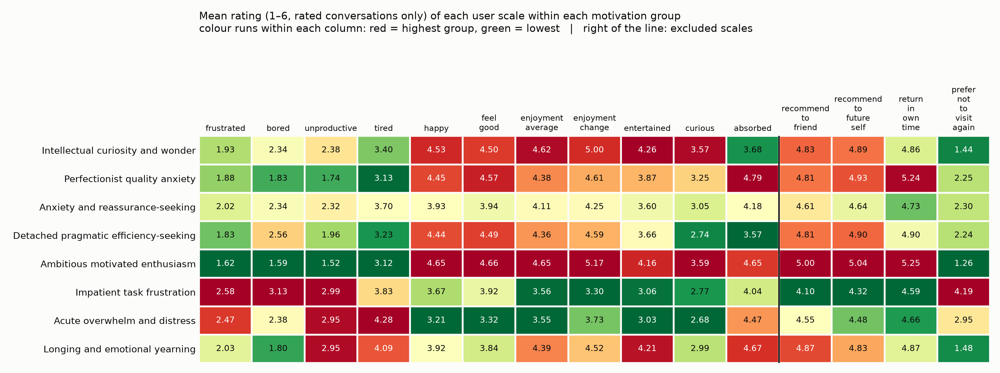

# Supplementary material

This document contains supporting material for [`report.md`](report.md). All values were produced by [`ingratiation_analysis.ipynb`](ingratiation_analysis.ipynb); the source tables are located in `outputs/tables/`.

---

## S1. Direction of the user scales: known-groups check

**Content of the figure.** Each cell shows the mean rating (1–6) of one user scale among the conversations of one motivation group. Only rated conversations are included; `not_applicable` is excluded. Colours are scaled within each column: red indicates the motivation group with the highest mean on that scale and green the lowest. The eleven scales used in the analysis appear to the left of the vertical line; the four excluded 1–6 scales appear to the right. The fifth excluded scale, `challenged`, is not shown because it uses a 1–4 scale, so its means are not comparable with those of the other scales.

**Rationale.** The anchors of the 1–6 scales are not published, so the data alone do not indicate whether a rating of 6 denotes a high or a low degree of a state. The motivation groups carry Claude-generated descriptions (report Section 3.3). For example, "Impatient task frustration" describes frustrated and impatient users, and "Ambitious motivated enthusiasm" describes enthusiastic, goal-directed users. If the frustration group obtains the highest mean on `frustrated` and the enthusiasm group the lowest, a higher value indicates more frustration.

**Result.** For almost every scale, the groups whose descriptions correspond to the state obtain the highest means: the frustration group on `frustrated` (2.58, compared with 1.62 for the enthusiasm group), `bored` and `unproductive`; the enthusiasm group on `happy`, `feel_good` and the enjoyment scales; and the acute overwhelm and distress group on `tired` (4.28, compared with 3.12 for the enthusiasm group). The exception is `curious`, on which the enthusiasm group (3.59) obtains a marginally higher mean than the intellectual curiosity group (3.57); both are clearly above all other groups (at most 3.25). All scales were therefore interpreted as **higher value = more of the named state**. `enjoyment_change` was interpreted as 1 = enjoyment decreased, 6 = enjoyment increased: the frustration group obtains the lowest mean (3.30) and the enthusiasm group the highest (5.17). `absorbed` is the least clear case: the intellectual curiosity group obtains one of the lowest means (3.68), whereas the perfectionist group (4.79) and the emotional groups obtain the highest. The scale appears to reflect emotional investment rather than intellectual immersion.

**Caution.** Averaging the ratings 1–6 treats them as equally spaced values. This is acceptable for establishing the direction of a scale, but the means are not reported as results. Because the motivation groups were labelled by the same model, this check demonstrates that the scales are applied consistently with their names, not that they measure users' actual feelings.

Source: `07_known_groups_motivation.csv`.

---

## S2. Spread and `not_applicable` share of every user scale

**Spread** denotes the difference between the highest and the lowest group mean in S1, that is, the extent to which a scale separates the eight motivation groups. **n/a** denotes the share of all conversations in which the state was not rated.

| User scale | Spread | Highest group | Lowest group | n/a % | Decision |
|---|---|---|---|---|---|
| enjoyment_change | 1.87 | Ambitious motivated enthusiasm | Impatient task frustration | 48.2 | kept (1 = fell, 6 = rose) |
| bored | 1.54 | Impatient task frustration | Ambitious motivated enthusiasm | 71.9 | kept |
| unproductive | 1.47 | Impatient task frustration | Ambitious motivated enthusiasm | 68.4 | kept |
| happy | 1.44 | Ambitious motivated enthusiasm | Acute overwhelm and distress | 52.5 | kept |
| feel_good | 1.34 | Ambitious motivated enthusiasm | Acute overwhelm and distress | 73.3 | kept |
| entertained | 1.23 | Intellectual curiosity and wonder | Acute overwhelm and distress | 54.9 | kept |
| absorbed | 1.22 | Perfectionist quality anxiety | Detached pragmatic efficiency-seeking | 5.8 | kept with caution (see S1) |
| tired | 1.16 | Acute overwhelm and distress | Ambitious motivated enthusiasm | 77.8 | kept |
| enjoyment_average | 1.10 | Ambitious motivated enthusiasm | Acute overwhelm and distress | 45.7 | kept |
| frustrated | 0.96 | Impatient task frustration | Ambitious motivated enthusiasm | 39.3 | kept |
| curious | 0.91 | Ambitious motivated enthusiasm | Acute overwhelm and distress | 8.8 | kept |
| recommend_to_friend | 0.90 | Ambitious motivated enthusiasm | Impatient task frustration | 40.6 | dropped: ceiling effect |
| recommend_to_future_self | 0.72 | Ambitious motivated enthusiasm | Impatient task frustration | 25.9 | dropped: ceiling effect, weak spread |
| return_in_own_time | 0.66 | Ambitious motivated enthusiasm | Impatient task frustration | 25.9 | dropped: weakest spread |
| prefer_not_to_visit_again | 2.93 | Impatient task frustration | Ambitious motivated enthusiasm | 95.7 | dropped: almost all n/a |
| challenged | – | – | – | 97.1 | dropped: different scale (1–4), almost all n/a |

For the three "return / recommend" scales, nearly every group has a mean of approximately 5; only the frustration group is lower, so these scales mainly distinguish frustrated users from all others. `prefer_not_to_visit_again` shows a large spread, but it is based on only the 4.3% of conversations in which it was rated.

Sources: `07_scale_selection.csv`, `07_user_facet_distribution.csv`.

---

## S3. What the ingratiation / withdrawal labels contain

Each column represents one category of `model_ingratiation_withdrawal`. Each value is the share (%) of the conversations in that column that received the label in the row on another behaviour facet. Within each block (one other facet), every column sums to 100. All facets were labelled by the same model; the table therefore shows how the labels are applied together, not what Claude actually did.

| Other facet | Category | Ingratiation | Mixed | n/a | Withdrawal |
|---|---|---|---|---|---|
| Encouragement / discouragement | encouragement | **76.9** | 40.1 | 26.8 | 32.1 |
|  | discouragement | 0.6 | 3.4 | 0.5 | 3.7 |
|  | mixed | 13.6 | 35.4 | 3.4 | 10.1 |
|  | n/a | 8.8 | 21.0 | 69.3 | 54.1 |
| Flattery / challenge | flattery | **19.1** | 3.2 | 2.0 | 3.0 |
|  | challenge | 5.2 | 17.6 | 3.2 | 17.1 |
|  | mixed | 40.3 | 36.9 | 2.8 | 8.9 |
|  | n/a | 35.4 | 42.2 | 92.0 | 71.0 |
| Assent / dissent | assent | **46.6** | 30.9 | 20.6 | 27.7 |
|  | dissent | 20.1 | **36.6** | 4.0 | 16.6 |
|  | n/a | 33.2 | 32.5 | 75.4 | 55.8 |
| Espousal of facts / norms | facts | 46.3 | 53.2 | 54.8 | **65.6** |
|  | norms | 13.9 | 6.8 | 2.6 | 6.1 |
|  | mixed | 34.1 | 39.4 | 9.3 | 14.0 |
|  | n/a | 5.7 | 0.7 | 33.3 | 14.3 |
| Conformism / eccentricity | conformism | 73.7 | 80.0 | 61.9 | 75.1 |
|  | eccentricity | 21.5 | 19.0 | 8.7 | 11.2 |
|  | n/a | 4.9 | 1.0 | 29.3 | 13.8 |
| Refusal / compliance | compliance | 90.3 | 86.6 | 70.5 | 86.6 |
|  | refusal | 1.9 | **8.7** | 0.5 | 3.6 |
|  | n/a | 7.8 | 4.7 | 29.0 | 9.8 |

**Interpretation.** Ingratiation conversations are predominantly encouraging and show the highest shares of flattery and assent, although one in five is also labelled as dissent. Withdrawal conversations are the most factual and are mostly not evaluated on encouragement or flattery at all, with little evidence of hostility (discouragement 3.7%, refusal 3.6%). Mixed conversations show the highest shares of dissent and refusal. Conversations that are `not_applicable` on ingratiation/withdrawal are `not_applicable` on almost every other facet as well, which suggests that they are conversations with little content.

Source: `04_label_profile.csv` (combining the six `04_label_meaning__x__*.csv` tables).

---

## S4. Handling of suppressed cells

Cross-tabulation cells with too few conversations are suppressed in the dataset for privacy reasons. In the tables used in this analysis, **2 cells are suppressed**, both in the ingratiation/withdrawal × `feel_good` table, which therefore covers 245,913 rather than 245,927 conversations. No cross-tabulation cells are suppressed in the motivation tables (report Figures 1 and 4). Separately, entire clusters are missing from the motivation facet: its eight level-1 groups contain 242,598 rather than 245,927 conversations (report Section 3.3). Suppressed cells are left empty in all saved tables and treated as 0 only within calculations (Cramér's V, shares and residuals). The Anthropic appendix notes that, where the categories of a facet are exhaustive, a suppressed count can be recovered by subtraction (the cluster total minus the visible categories). This procedure was **not applied**; with 2 cells out of several hundred, it would have a negligible effect on the results.

Source: `08_pair_summary.csv` (column `suppressed_cells`), `06_motivation_x_ingratiation_v.csv`.

---

## S5. Motivation groups on four other behaviour facets: full tables

Each table reports, for every motivation group, the share (%) of each category of one behaviour facet, the difference from the whole sample in percentage points (in brackets), and the corresponding number of conversations. These tables provide the group shares that are not displayed in report Figure 4, which shows only the differences. Groups are ordered by their share of ingratiation, as in report Figures 1 and 4. Every value describes an entire motivation group; the data do not allow it to be restricted to the group's conversations labelled ingratiation or withdrawal. For the two smallest groups (longing, 2,442 conversations; acute overwhelm and distress, 3,570), values in rare categories are based on few conversations, for example 145 and 143 refusals respectively.

### S5a. Flattery / challenge

| Motivation group | Flattery | Mixed | n/a | Challenge |
|---|---|---|---|---|
| Longing and emotional yearning | 21.9 (+14.0) · 535 | 39.8 (+20.7) · 973 | 33.4 (−29.0) · 815 | 4.9 (−5.6) · 119 |
| Acute overwhelm and distress | 7.8 (−0.1) · 279 | 40.8 (+21.7) · 1,458 | 39.7 (−22.7) · 1,419 | 11.6 (+1.1) · 414 |
| Ambitious motivated enthusiasm | 12.1 (+4.2) · 5,715 | 26.7 (+7.5) · 12,558 | 54.1 (−8.3) · 25,440 | 7.1 (−3.4) · 3,342 |
| Anxiety and reassurance-seeking | 8.7 (+0.8) · 2,843 | 32.1 (+12.9) · 10,460 | 46.5 (−15.9) · 15,150 | 12.7 (+2.3) · 4,156 |
| Intellectual curiosity and wonder | 7.4 (−0.5) · 1,843 | 16.7 (−2.4) · 4,166 | 68.5 (+6.1) · 17,047 | 7.3 (−3.1) · 1,825 |
| Perfectionist quality anxiety | 9.8 (+1.8) · 2,341 | 19.1 (−0.0) · 4,578 | 57.2 (−5.2) · 13,669 | 13.9 (+3.4) · 3,324 |
| Impatient task frustration | 5.2 (−2.8) · 2,740 | 12.7 (−6.5) · 6,732 | 66.6 (+4.2) · 35,241 | 15.5 (+5.1) · 8,217 |
| Detached pragmatic efficiency-seeking | 5.6 (−2.4) · 3,070 | 9.9 (−9.3) · 5,441 | 79.1 (+16.7) · 43,664 | 5.5 (−5.0) · 3,024 |
| **Whole sample** | 8.0 | 19.2 | 62.4 | 10.5 |

### S5b. Assent / dissent

| Motivation group | Assent | n/a | Dissent |
|---|---|---|---|
| Longing and emotional yearning | 38.3 (+5.8) · 935 | 35.1 (−16.3) · 856 | 26.7 (+10.5) · 651 |
| Acute overwhelm and distress | 40.2 (+7.8) · 1,436 | 33.0 (−18.4) · 1,177 | 26.8 (+10.6) · 957 |
| Ambitious motivated enthusiasm | 40.5 (+8.0) · 19,046 | 46.0 (−5.4) · 21,648 | 13.5 (−2.7) · 6,361 |
| Anxiety and reassurance-seeking | 36.8 (+4.3) · 11,989 | 38.0 (−13.4) · 12,396 | 25.2 (+9.0) · 8,224 |
| Intellectual curiosity and wonder | 26.3 (−6.2) · 6,543 | 60.4 (+9.1) · 15,034 | 13.3 (−2.9) · 3,304 |
| Perfectionist quality anxiety | 39.0 (+6.5) · 9,328 | 40.6 (−10.8) · 9,698 | 20.4 (+4.3) · 4,886 |
| Impatient task frustration | 29.5 (−2.9) · 15,637 | 52.3 (+1.0) · 27,705 | 18.1 (+1.9) · 9,588 |
| Detached pragmatic efficiency-seeking | 25.5 (−6.9) · 14,082 | 67.0 (+15.6) · 36,969 | 7.5 (−8.7) · 4,148 |
| **Whole sample** | 32.5 | 51.4 | 16.2 |

### S5c. Conformism / eccentricity

| Motivation group | Conformism | n/a | Eccentricity |
|---|---|---|---|
| Longing and emotional yearning | 61.0 (−11.2) · 1,490 | 6.8 (−6.6) · 166 | 32.2 (+17.8) · 786 |
| Acute overwhelm and distress | 67.9 (−4.3) · 2,425 | 6.4 (−7.0) · 228 | 25.7 (+11.3) · 917 |
| Ambitious motivated enthusiasm | 71.6 (−0.5) · 33,714 | 13.8 (+0.3) · 6,474 | 14.6 (+0.2) · 6,867 |
| Anxiety and reassurance-seeking | 72.5 (+0.3) · 23,646 | 8.8 (−4.6) · 2,871 | 18.7 (+4.3) · 6,092 |
| Intellectual curiosity and wonder | 69.0 (−3.2) · 17,176 | 10.8 (−2.6) · 2,699 | 20.1 (+5.7) · 5,006 |
| Perfectionist quality anxiety | 77.1 (+4.9) · 18,427 | 12.0 (−1.4) · 2,875 | 10.9 (−3.5) · 2,610 |
| Impatient task frustration | 76.8 (+4.6) · 40,627 | 11.9 (−1.5) · 6,305 | 11.3 (−3.1) · 5,998 |
| Detached pragmatic efficiency-seeking | 68.6 (−3.6) · 37,878 | 20.3 (+6.9) · 11,196 | 11.1 (−3.3) · 6,125 |
| **Whole sample** | 72.2 | 13.4 | 14.4 |

### S5d. Refusal / compliance

| Motivation group | Refusal | n/a | Compliance |
|---|---|---|---|
| Longing and emotional yearning | 5.9 (+3.2) · 145 | 18.9 (+6.1) · 462 | 75.1 (−9.4) · 1,835 |
| Acute overwhelm and distress | 4.0 (+1.3) · 143 | 18.2 (+5.4) · 649 | 77.8 (−6.7) · 2,778 |
| Ambitious motivated enthusiasm | 2.0 (−0.7) · 952 | 11.0 (−1.8) · 5,189 | 86.9 (+2.4) · 40,914 |
| Anxiety and reassurance-seeking | 2.8 (+0.2) · 929 | 12.9 (+0.1) · 4,213 | 84.2 (−0.3) · 27,467 |
| Intellectual curiosity and wonder | 2.5 (−0.2) · 611 | 15.9 (+3.1) · 3,950 | 81.7 (−2.8) · 20,320 |
| Perfectionist quality anxiety | 1.2 (−1.5) · 275 | 9.0 (−3.8) · 2,160 | 89.8 (+5.3) · 21,477 |
| Impatient task frustration | 2.6 (−0.1) · 1,367 | 10.0 (−2.8) · 5,295 | 87.4 (+2.9) · 46,268 |
| Detached pragmatic efficiency-seeking | 2.0 (−0.7) · 1,118 | 16.7 (+3.9) · 9,232 | 81.2 (−3.3) · 44,849 |
| **Whole sample** | 2.7 | 12.8 | 84.5 |

*Format: share in % (difference from the whole sample in percentage points) · number of conversations.*

Sources: `09_profile__flattery_challenge.csv`, `09_profile__assent_dissent.csv`, `09_profile__conformism_eccentricity.csv`, `09_profile__refusal_compliance.csv`.
